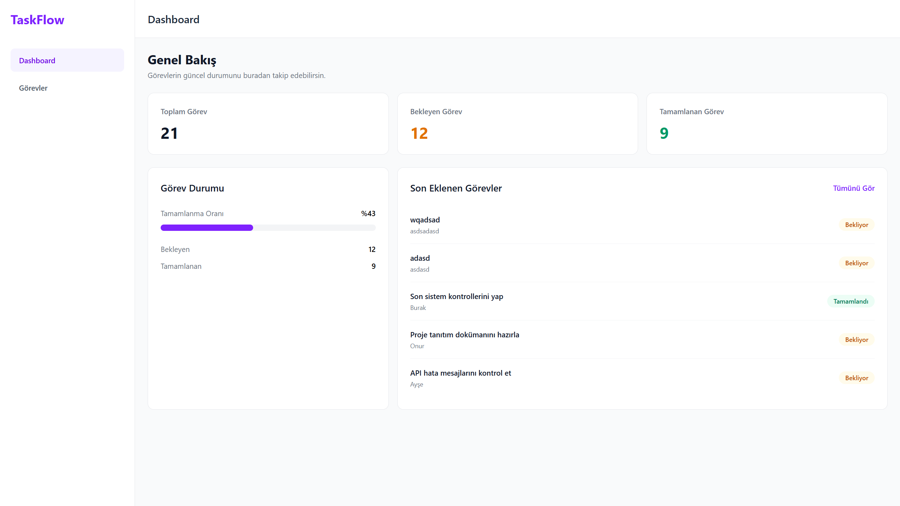
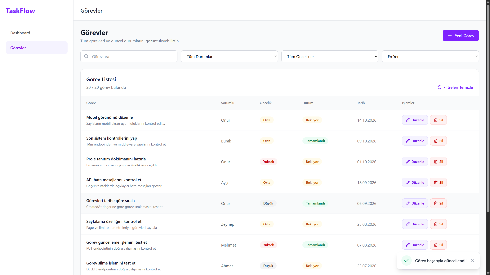
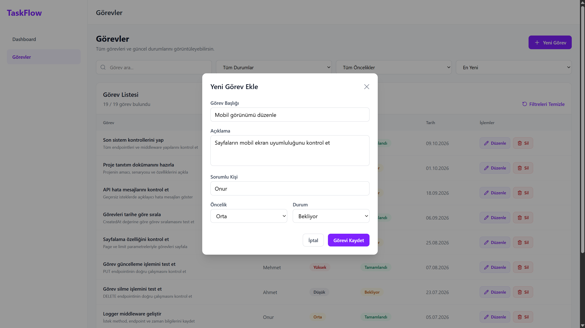
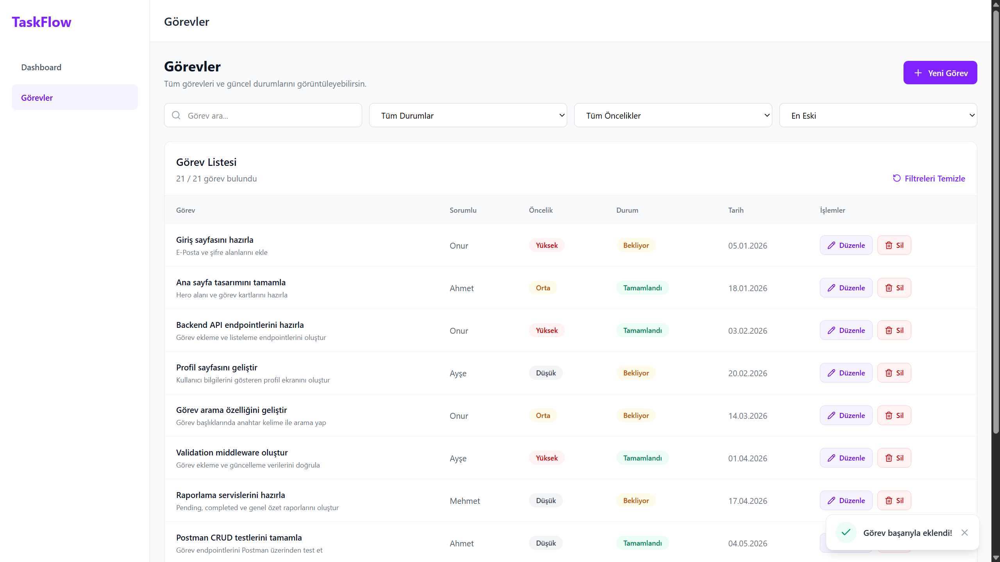
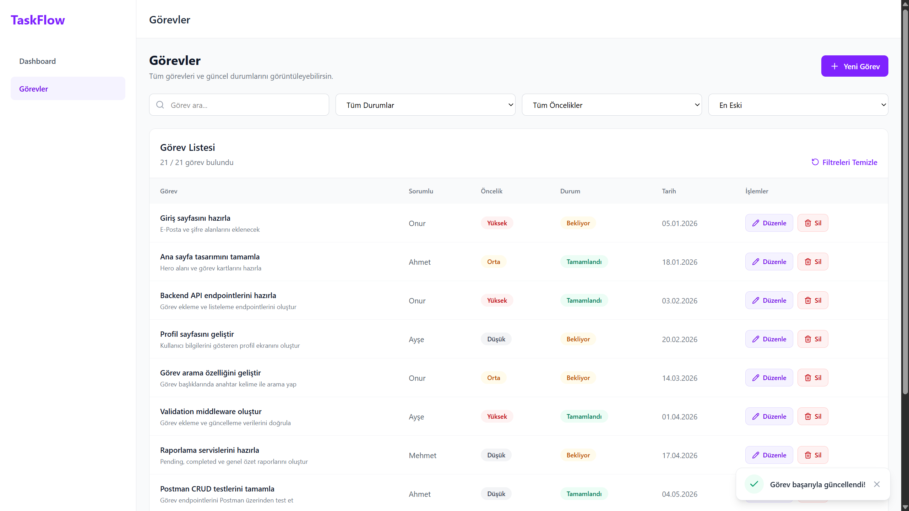
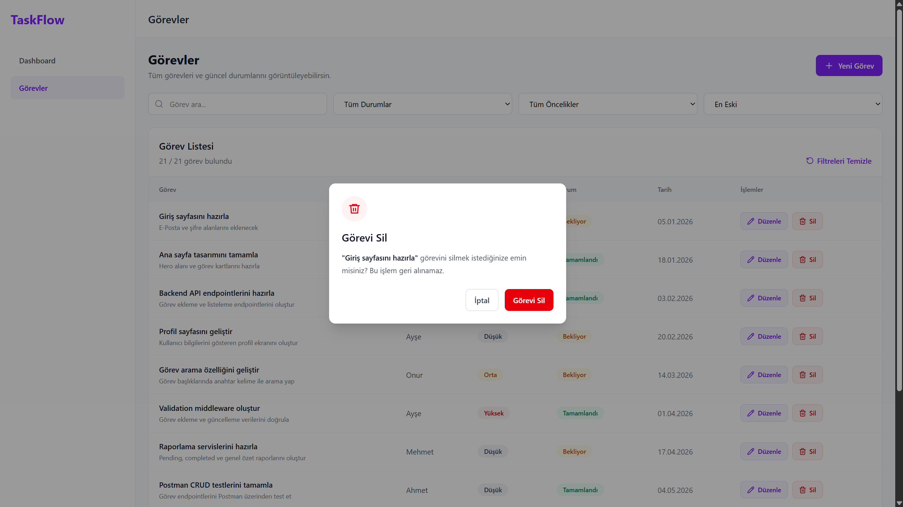
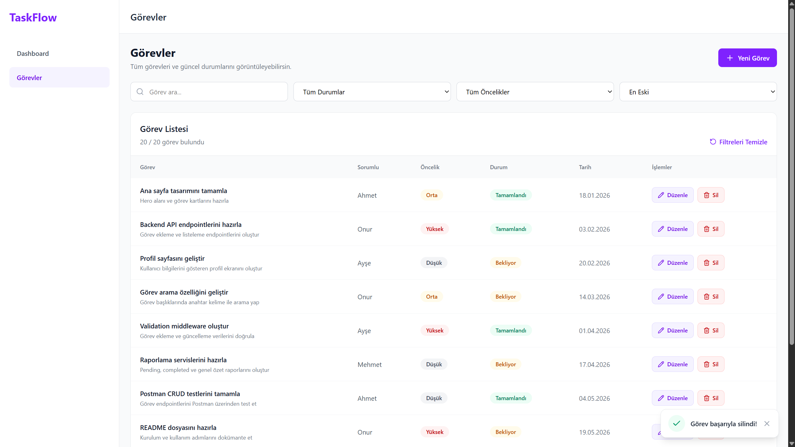
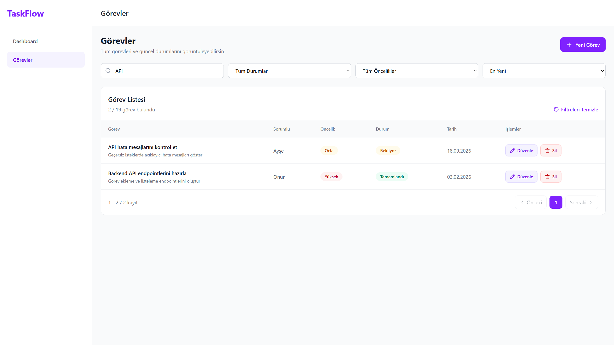

# TaskFlow - Görev Yönetim Uygulaması

TaskFlow, React ve JavaScript kullanılarak geliştirilmiş modern ve kullanıcı dostu bir görev yönetim uygulamasıdır.

Bu proje, Web Geliştirme JavaScript eğitimi kapsamında hazırlanmıştır. React ile CRUD işlemleri, state yönetimi, form validasyonu, sayfalama ve LocalStorage kullanımını öğrenmek amacıyla geliştirilmiştir.

# TaskFlow - Görev Yönetim Uygulaması

TaskFlow, React ve JavaScript kullanılarak geliştirilmiş modern ve kullanıcı dostu bir görev yönetim uygulamasıdır.

Bu proje, Web Geliştirme JavaScript eğitimi kapsamında hazırlanmıştır. React ile CRUD işlemleri, state yönetimi, form validasyonu, sayfalama ve LocalStorage kullanımını öğrenmek amacıyla geliştirilmiştir.

## Canlı Demo

TaskFlow uygulamasını aşağıdaki bağlantıdan inceleyebilirsiniz:

[TaskFlow - Canlı Uygulamayı Aç](https://taskflow-frontend-alpha-seven.vercel.app/dashboard)

## Özellikler

- Dashboard üzerinden görev istatistiklerini görüntüleme
- Yeni görev oluşturma
- Mevcut görevleri listeleme
- Görev bilgilerini düzenleme
- Onay modalı ile görev silme
- Görev başlığına göre arama
- Durum ve önceliğe göre filtreleme
- Tarihe göre sıralama
- Görev tablosunda 10 kayıtlık sayfalama (Pagination)
- Önceki, Sonraki ve sayfa numaralarıyla gezinme
- Sayfa geçişlerinde yumuşak kaydırma animasyonu
- Form validasyonları ve hata mesajları
- Başarılı işlemler için Toast bildirimleri
- Lucide React ile modern ve tutarlı ikon kullanımı
- LocalStorage ile verileri saklama
- Responsive tasarım

## Kullanılan Teknolojiler

| Teknoloji | Kullanım Amacı |
|-----------|----------------|
| React | Kullanıcı arayüzü |
| JavaScript | Uygulama işlevleri |
| Vite | Proje geliştirme ve derleme |
| Tailwind CSS | Arayüz tasarımı |
| React Router | Sayfa yönlendirmeleri |
| Lucide React | Uygulama ikonları |
| LocalStorage | Tarayıcıda veri saklama |
| Git & GitHub | Versiyon kontrolü |
| Vercel | Uygulamanın yayınlanması |

## Uygulama Ekranları

### Dashboard

Dashboard ekranında:

- Toplam görev sayısı
- Bekleyen görev sayısı
- Tamamlanan görev sayısı
- Görev tamamlanma oranı
- Son eklenen görevler

görüntülenir.

### Görevler

Görevler sayfasında görev ekleme, listeleme, güncelleme ve silme işlemleri yapılabilir.

Her görev aşağıdaki bilgileri içerir:

- Başlık
- Açıklama
- Sorumlu kişi
- Öncelik
- Durum
- Oluşturulma tarihi

### Arama ve Filtreleme

Kullanıcılar görev listesinde:

- Görev başlığına göre arama yapabilir.
- Bekleyen ve tamamlanan görevleri filtreleyebilir.
- Düşük, orta ve yüksek öncelikli görevleri filtreleyebilir.
- Görevleri oluşturulma tarihine göre sıralayabilir.
- Aktif filtreleri temizleyebilir.

### Sayfalama (Pagination)

Görev tablosunda kayıtlar sayfalara ayrılarak görüntülenir.

- Her sayfada en fazla 10 görev gösterilir.
- Sayfa numaralarıyla istenilen sayfaya geçilebilir.
- Önceki ve Sonraki butonları kullanılabilir.
- Arama veya filtreleme değiştiğinde ilk sayfaya dönülür.
- Toplam kayıt ve görüntülenen kayıt aralığı gösterilir.
- Sayfa geçişlerinde yumuşak kaydırma animasyonu kullanılır.

Sayfalama tasarımı `src/components/ui/Pagination.jsx` dosyasında, sayfalama hesaplamaları ise `src/utils/pagination.js` dosyasında bulunmaktadır.

## Proje Klasör Yapısı

```text
src/
├── components/
│   ├── layout/
│   │   ├── DashboardLayout.jsx
│   │   ├── Navbar.jsx
│   │   └── Sidebar.jsx
│   └── ui/
│       ├── ConfirmModal.jsx
│       ├── Pagination.jsx
│       ├── StatCard.jsx
│       ├── TaskModal.jsx
│       └── Toast.jsx
├── data/
│   └── tasks.js
├── pages/
│   ├── Dashboard.jsx
│   └── Tasks.jsx
├── utils/
│   └── pagination.js
├── validations/
│   └── taskValidation.js
├── App.jsx
├── index.css
└── main.jsx
```

## Kurulum

Projeyi bilgisayarınıza indirin:

```bash
git clone https://github.com/onuraydinoglu/taskflow-frontend.git
```

Proje klasörüne girin:

```bash
cd taskflow-frontend
```

Gerekli paketleri yükleyin:

```bash
npm install
```

Projeyi başlatın:

```bash
npm run dev
```

## Veri Saklama

TaskFlow uygulamasında backend veya veritabanı bağlantısı bulunmamaktadır.

Görevler React state ile yönetilir ve LocalStorage üzerinde saklanır.

Sayfa yenilendiğinde kullanıcı tarafından eklenen, düzenlenen veya silinen görevlerin durumu korunur.

Veriler yalnızca ilgili tarayıcıda saklanır. Farklı cihazlar arasında otomatik senkronizasyon yapılmaz.

## Form Validasyonu

Görev ekleme ve düzenleme işlemlerinde form doğrulamaları kullanılmaktadır.

Validasyon işlemleri `src/validations/taskValidation.js` dosyasında bulunmaktadır.

- Görev başlığı: 3-100 karakter
- Açıklama: 10-500 karakter
- Sorumlu kişi: 2-50 karakter
- Öncelik: Düşük, Orta veya Yüksek
- Durum: Bekliyor veya Tamamlandı

Hatalı alanlarda kullanıcıya açıklayıcı mesajlar gösterilmektedir.


## Ekran Görüntüleri

















